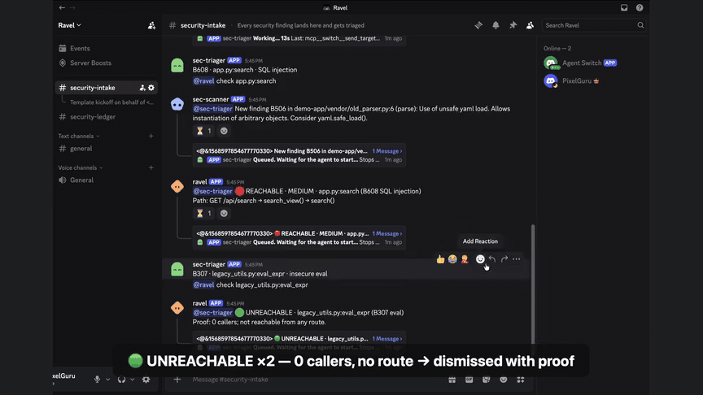
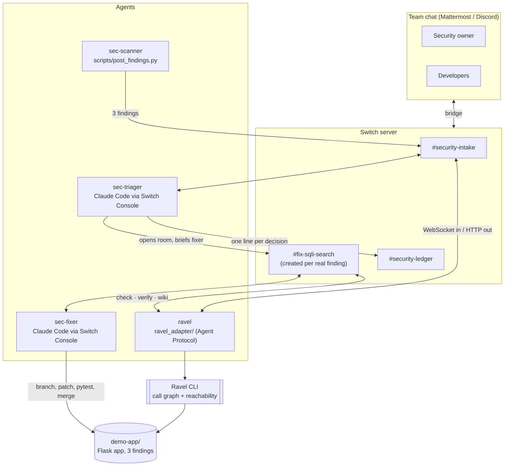

# Ravel Security Room

**AI writes more code than humans can review. Agents sort real vulnerabilities from noise,
fix the real one, prove the fix, and a human approves in chat.**

A [Switch](https://github.com/sandbox-quantum/switch) workflow for the *Flip the Switch*
hackathon (Track 1, Best Business Workflow). Security findings land in a team chat room;
AI agents triage them with call-graph proof from [Ravel](https://github.com/shreychechani/Ravel),
fix the one that matters on a branch, prove the fix, and merge only after the security
owner types `@sec-fixer approved`.

<!-- TODO: demo GIF -->


▶️ **3-minute demo video:** <!-- TODO: link --> *(link coming)*

```
3 scanner findings in
  → 2 dismissed with call-graph proof   (no route can reach them)
  → 1 fixed on a branch by an agent     (SQL injection, reachable from GET /api/search)
  → verified by Ravel                   (re-scan of the branch: finding gone)
  → 1 human "approved" in chat          → merged, and logged in #security-ledger
```

---

## The problem

Scanners like bandit flag dozens of "possible vulnerabilities" per repo, and AI-written code
makes the pile grow faster than anyone can read it. Most findings are noise: dead code,
vendored files nobody imports. So teams stop reading, and the one real bug ships.

What a security engineer actually asks for each finding is: **can outside input reach this
line?** Ravel answers that from the code's call graph, and Switch puts that answer, the fix
and the human decision in the room where the team already works.

## What happens in the demo

All of this is visible in chat; nobody leaves the chat app.

1. **Findings arrive.** `scripts/post_findings.py` posts bandit's 3 findings into
   `#security-intake` as the `sec-scanner` agent.
2. **sec-triager restates each one and asks ravel**, one command per message:
   ```
   @ravel check app.py:search
   ```
3. **ravel answers with proof**, taken from Ravel's call graph, not from an LLM guess:
   ```
   @sec-triager 🔴 REACHABLE · MEDIUM · app.py:search (B608 SQL injection)
   Path: GET /api/search → search_view() → search()

   @sec-triager 🟢 UNREACHABLE · legacy_utils.py:eval_expr (B307 eval)
   Proof: 0 callers; not reachable from any route.

   @sec-triager 🟢 UNREACHABLE · vendor/old_parser.py:parse (B506 unsafe yaml.load)
   Proof: 0 callers; not reachable from any route.
   ```
4. **Two dismissed, one routed.** sec-triager dismisses the two unreachable findings with
   ravel's proof line, then opens a new room `#fix-sqli-search` with sec-fixer, ravel and the
   security owner.
5. **Knowledge attached.** In the fix room, `@ravel attach wiki app` saves the module's wiki
   page (functions, routes, callers, open findings) as a **room document**, so every agent in
   the room can read it.
6. **sec-fixer fixes it** on branch `fix/sqli-search`: a parameterized query, `pytest` passes
   (the planted `test_search_blocks_sql_injection` goes from red to green), then:
   ```
   @ravel verify fix/sqli-search search
   @sec-fixer ✅ FIX VERIFIED on fix/sqli-search · B608 gone from search(); 0 reachable findings
   Callers of search(): search_view (GET /api/search)
   ```
7. **The approval gate.** sec-fixer posts the diff, the test result and ravel's verdict, and
   asks the security owner. Only `@sec-fixer approved` from the security owner's own account
   merges. "looks good", "ok", or "approved" from anyone else does not.
8. **The ledger.** sec-triager writes one line per decision in `#security-ledger`:
   ```
   🟢 Dismissed | B307 legacy_utils.py:eval_expr | unreachable (ravel) | 2026-11-07
   🟢 Dismissed | B506 vendor/old_parser.py:parse | unreachable (ravel) | 2026-11-07
   ✅ Fixed | B608 app.py:search | verified by ravel | approved by @<security owner> | 2026-11-07
   ```

Developers can also **Ask Ravel** in any room it is in: `@ravel who calls process_payment`
(→ `checkout_view()` on `POST /api/checkout`, and `retry_job()`), or `@ravel wiki payments`.

## How Switch is used

The workflow does not exist without Switch: Switch is what puts the agents in the chat,
routes messages between them, creates the rooms and enforces who may instruct whom.

| Switch feature | How we use it |
| --- | --- |
| **Rooms** | `#security-intake` (every finding), one `#fix-<kind>-<function>` room **per real finding**, created at run time by sec-triager with its Switch tools (`create_room`, `invite_agent_to_room`, `add_users_to_room`), and `#security-ledger` (audit trail) |
| **Multiple agents** | Two Console-run Claude Code agents (sec-triager, sec-fixer) plus two custom agents of ours (ravel, sec-scanner) |
| **Agent addressing** | Agents wake only when `@mentioned`. Every ravel reply starts with `@<asker>`, which is what hands the turn back to the agent that asked |
| **Who may instruct whom** | sec-fixer has `addressing: owner-agents`: if anyone but its owner (or the owner's agents) types `@sec-fixer approved`, **Switch refuses the message** before the agent ever sees it. sec-triager and ravel are `anyone`, so any developer can report an issue or ask ravel |
| **Human approval gate** | Three layers: Switch addressing (above), sec-fixer's instructions (only the exact `approved` from the security owner's human account counts), and proof first (it may only ask after `pytest` passes and ravel says `FIX VERIFIED`). Bypass permissions stay **off** for sec-fixer |
| **Attached knowledge** | ravel writes the affected module's wiki into the fix room as a room document (`create_room_document` / `update_room_document`) |
| **Agent Protocol** | ravel is our own program, not a Console template: it connects to Switch over **WebSocket (events in)** and **HTTP (messages out)**, answers pings, resumes from a saved cursor after a drop, and never answers a message twice. See [`ravel_adapter/README.md`](ravel_adapter/README.md) |
| **Templates** | [`switch/security-room.template.yaml`](switch/security-room.template.yaml) (format version 2) creates both agents, both rooms, their link and their instructions in one import. It asks for the security owner's chat username and fills it into every agent's instructions |
| **Bridges** | The full flow ran end to end on both Mattermost (bundled with Switch Console, used for development) and Discord (used for the demo). Same template, same agents; only the **Messaging app** choice differs |

> Switch room *roles* are hats that agents wear, not human permissions, so the approval gate
> is built on addressing plus instructions, not on roles. More in
> [`docs/ARCHITECTURE.md`](docs/ARCHITECTURE.md) §5.

## Architecture



How a single message travels (chat → Switch → agent → ravel → chat) is drawn step by step
in [`docs/ARCHITECTURE.md`](docs/ARCHITECTURE.md) §3.

---

## Quickstart

Two parts. **Part A** needs no Switch and takes about 5 minutes: it shows Ravel's verdicts and
an offline simulation of the full workflow. **Part B** runs the real thing in chat (about 15
more minutes).

### Prerequisites

- Python **3.11+** and git
- [`uv`](https://docs.astral.sh/uv/) and Python **3.12+** for Ravel
- For Part B only: [Docker Desktop](https://www.docker.com/products/docker-desktop/) (runs the
  bundled Mattermost) and [Switch Console](https://github.com/sandbox-quantum/switch)

### Part A: no Switch needed

```bash
# Clone both repos side by side
git clone https://github.com/shreychechani/ravel-security-room.git
git clone https://github.com/shreychechani/Ravel.git
(cd Ravel && uv sync)

cd ravel-security-room
python3 -m venv .venv && source .venv/bin/activate     # Windows: .venv\Scripts\activate
pip install -r requirements.txt
cp .env.example .env                                   # RAVEL_DIR=../Ravel matches this layout

./scripts/scan.sh               # 3 findings: B608, B307, B506
pytest demo-app/tests -q        # 1 failed, 1 passed: the SQL injection test fails until the fix

# Ask Ravel directly, the same answers it gives in chat
python ravel_adapter/adapter.py "@ravel check app.py:search"
python ravel_adapter/adapter.py "@ravel check legacy_utils.py:eval_expr"
python ravel_adapter/adapter.py "@ravel check vendor/old_parser.py:parse"
python ravel_adapter/adapter.py "@ravel who calls process_payment"
python ravel_adapter/adapter.py "@ravel wiki app"

# Walk through all 8 workflow steps offline, with mock agents (26 checks)
python scripts/simulate_workflow.py
```

The demo app itself: `python demo-app/app.py`, then open
`http://127.0.0.1:8080/api/search?q=almo`. (It runs on 8080: macOS uses 5000 for AirPlay.)

### Part B: the real workflow in chat

**Using Discord instead of Mattermost?** Connect it first, before importing the template
(Switch Console → server **Home** → **Messaging apps** → **Connect** → **Discord**; the
[Switch docs](https://docs.switchagents.ai/switch-rooms/deploy/messaging-apps/discord) cover the Developer Portal
steps: a bot with the **Server Members** and **Message Content** intents, invited with the
`bot` and `applications.commands` scopes). Name the connection `Discord`, and on the next screen
choose **This is me** to link your own account: until you do, sec-fixer does not recognize you
as its owner. In step 4, your chat username is your Discord **username** (not the display name).

**1. Start Switch.** Open Docker Desktop, then Switch Console → **Run a server on this
computer**. Wait for "Running locally", then sign in to the bundled Mattermost from Console
(Home → Messaging apps). Keep Docker Desktop open for the whole run; Mattermost lives in it.

The adapter finds the server's port by itself (Console writes it to `ports.json`), so leave
`SWITCH_URL` empty in `.env`.

**2. Register our two custom agents** (once). The template refers to them, so they must exist
before you import it.

```bash
python -m ravel_adapter.registration_key     # creates a registration key and saves it in .env
python -m ravel_adapter.register ravel        # saves ravel's id and key in .env
python -m ravel_adapter.register sec-scanner  # the identity that posts findings
```

`registration_key` asks for the Switch Gateway admin email and password (input is hidden).
If your Console shows a Gateway page, you can instead create the key under **API Keys** and
paste it after `SWITCH_REGISTRATION_KEY=` in `.env`.

**3. Start ravel from its own checkout.** sec-fixer switches branches in the repo folder,
so ravel runs from a separate worktree of `main` and its code never moves under it:

```bash
git worktree add --detach ../ravel-run main
ln -s "$PWD/.env" ../ravel-run/.env
(cd ../ravel-run && ../ravel-security-room/.venv/bin/python ravel_adapter/adapter.py)
```

Leave it running. It prints `connected` once it is listening.

**4. Import the template.** In Switch Console → **Templates** → **Import template** →
choose `switch/security-room.template.yaml` → **Use**. Fill in:
- **Your chat username (no @):** your username in the chat app (e.g. `user`), not your Switch
  account name. This person becomes the security owner, the only one whose approval merges.
- **Folder of your ravel-security-room clone:** clear the box first (it starts with the text
  `{repo_dir}`), then paste the full path. In the preview, sec-fixer's **Directory** must be
  exactly that path.

Select **Create all**. You get `#security-intake` and `#security-ledger`. sec-triager answers
the kickoff **and names the security owner**; if it says `{security_owner}` or nothing, the
gate isn't wired: delete the agents and rooms and import again.

Optional check: `python scripts/validate_template.py` checks the template offline first.

**5. Run it.**

```bash
python scripts/post_findings.py      # posts the 3 findings into #security-intake, 2 s apart
```

Then watch the chat: 2 dismissals, `#fix-sqli-search` opens, the wiki is attached, sec-fixer
fixes, ravel verifies, and sec-fixer asks you. Type **`@sec-fixer approved`** in the fix room.
sec-fixer merges and sec-triager writes the ledger.

**6. Run it again.**

```bash
./scripts/reset_demo.sh     # Windows: python scripts/reset_demo.py
```

This resets `main` to the `demo-base` tag (3 findings), deletes local `fix/*` branches and
re-runs the scan. It refuses to run if that would throw away anything outside `demo-app/`.
In Switch, delete the old `fix-*` room before the next run.

## Repo layout

| Path | What it is |
| --- | --- |
| `demo-app/` | Tiny Flask shop with 3 planted findings: SQL injection in `search()` (reachable from `/api/search`), `eval()` in `legacy_utils.eval_expr()` (never called), unsafe `yaml.load` in `vendor/old_parser.py` (never imported) |
| `demo-app/tests/` | `test_search_blocks_sql_injection` fails until the fix lands, on purpose |
| `switch/security-room.template.yaml` | The Switch template: sec-triager, sec-fixer, both rooms and every agent's instructions |
| `ravel_adapter/` | ravel as a Switch agent: the commands (`ravel.py`), the Agent Protocol client (`switch_client.py`), registration, and the pre-built wiki pages |
| `scripts/scan.sh`, `scan.py` | bandit scan; prints exactly the 3 demo findings |
| `scripts/post_findings.py` | Posts the findings into `#security-intake` as sec-scanner (`--dry-run` to preview) |
| `scripts/reset_demo.sh`, `reset_demo.py` | Makes the demo repeatable |
| `scripts/simulate_workflow.py` | Offline walk-through of the whole flow with mock agents |
| `scripts/validate_template.py` | Offline check of the template |
| `docs/ARCHITECTURE.md` | How it works and why (decisions log) |
| `docs/SWITCH_SETUP.md` | Longer Switch setup guide |

Tests: `pytest ravel_adapter/tests -q` (136 tests, no Switch needed).

## Limits and next steps

- **Python only, one repo.** Ravel analyzes Python; the adapter points at `demo-app/`
  (`DEMO_REPO_PATH` in `.env`). Next: any repo, and a scanner hook on every pull request
  instead of a script.
- **Reachability is static.** Ravel follows the call graph from web routes. Dynamic dispatch
  it can't resolve comes back as ⚪ UNKNOWN, and sec-triager then asks a human instead of
  dismissing.
- **One security owner.** Templates allow only `owner | owner-agents | anyone` addressing.
  Console's "Custom rules" could name a security team; it has to be set by hand on sec-fixer's page.
- **Local Switch server is single-user.** Each tester runs their own Console. Connect Discord
  so a whole team can talk to the agents.
- **Display name.** In Mattermost, ravel's replies currently show under the admin account
  rather than a bot account of their own.
- **Next:** one fix room per reachable finding in parallel, severity-based routing, and a
  weekly summary from the ledger.

## License

MIT, see [`LICENSE`](LICENSE). Built for *Flip the Switch* by WeMakeDevs × DevTools Academy,
powered by Switch.
