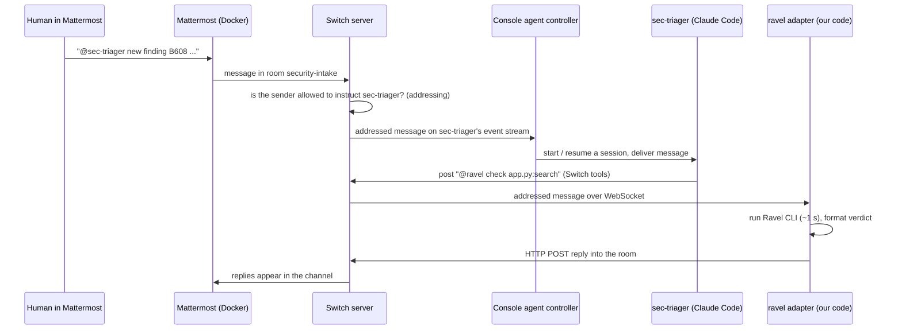

# Architecture — how Ravel Security Room works and why

Read this to understand the whole system before you change any part of it.
For *what's left and how to pick it up*, read [`HANDOFF.md`](./HANDOFF.md).
Written Nov 5, 2026. Facts about Switch come from `https://docs.switchagents.ai`
(use the `switch-docs` MCP server, never guess).

---

## 1. The problem and the idea

AI now writes more code than people can review. Scanners like bandit flag hundreds
of "possible vulnerabilities", most of them noise, so teams stop reading the reports.

Our answer is a team-chat workflow where AI agents do the boring part and a human
keeps the final say:

```
3 scanner findings in
  → 2 dismissed with proof (Ravel's call graph shows no outside input can reach them)
  → 1 real one fixed on a branch by an agent
  → Ravel proves the fix (re-scan: finding gone)
  → the security owner types "approved" in chat → merge
```

Everything happens in chat rooms, so the whole team can see every decision.

## 2. The pieces

| Piece | What it is | Where it runs |
| --- | --- | --- |
| **Mattermost** | The chat app (Slack-like). Each AI agent shows up as its own bot account | Docker container (the only thing in Docker) |
| **Switch server** (`switch-core`) | The brain: turns chat channels into **rooms**, knows who's in each room, routes messages to agents, enforces **who may instruct which agent** | Native process on the laptop, started by Switch Console |
| **Switch Gateway** | Admin web page for the Switch server (API keys, agents, machines) | Native, started by Console |
| **Switch Console** | Desktop app: starts the server, creates agents, and starts an agent's AI session when someone mentions it | Desktop app |
| **sec-triager** | AI agent (Claude Code). Reads findings, asks Ravel, dismisses or opens a fix room, writes the ledger | Started by Console when mentioned |
| **sec-fixer** | AI agent (Claude Code). Branches, patches, runs tests, asks Ravel to verify, merges only after human approval | Started by Console when mentioned |
| **ravel** | *Our* custom agent: a Python program (`ravel_adapter/`) that wraps the Ravel CLI and talks to Switch directly | `python ravel_adapter/adapter.py` |
| **sec-scanner** | A second identity our scripts use to post findings into `#security-intake` | `scripts/post_findings.py` |
| **Ravel** | Our reachability tool: builds a call graph of a Python repo and says whether outside input can reach each scanner finding | Separate repo, `github.com/shreychechani/Ravel` |
| **demo-app/** | Tiny Flask shop with 3 planted findings | `python demo-app/app.py`, port 8080 |

### Why Docker at all?
Docker runs programs in sealed boxes ("containers"). Here it runs **only Mattermost**.
If Docker Desktop is closed, the chat disappears, but the Switch server keeps running
(that happened once on Nov 4). Since Console 0.40 the Switch server itself runs natively.

## 3. How one message flows



Key points:
- **Agents are only woken up when addressed** (`@name`). Switch decides who may address whom.
- **Console-run agents** (sec-triager, sec-fixer) get their sessions started by Console.
- **ravel is different:** it is a long-running Python process that connects to the Switch
  server itself via the **Switch Agent Protocol**: WebSocket for events in, HTTP for messages out.
  It must answer the server's `ping` within 6 s, so Ravel commands run on a worker thread.

## 4. Rooms

| Room | Who's in it | Purpose |
| --- | --- | --- |
| `#security-intake` | sec-scanner, sec-triager, ravel, sec-fixer, security owner | Every finding lands here |
| `#fix-<name>` (e.g. `#fix-sqli-search`) | sec-fixer, ravel, security owner | One room per real finding. Ravel attaches the module's wiki as room knowledge |
| `#security-ledger` | sec-triager, security owner | One line per decision, an audit trail |

On Mattermost, adding an agent's bot to a channel is what creates the room.

## 5. The approval gate (three layers)

The gate is the core claim of the project, so it's layered:

1. **Switch addressing:** sec-fixer has `addressing: owner-agents`, so it accepts
   messages only from its owner (the person who ran the template, the security owner)
   and the owner's agents (sec-triager, ravel). Anyone else who types
   `@sec-fixer approved` gets a **visible refusal from Switch** before the agent sees it.
2. **Agent instructions:** sec-fixer merges only when the security owner's *human*
   account (named in the template's `security_owner` field) sends exactly
   `@sec-fixer approved` after sec-fixer asked. Anything else ("ok", "looks good"), or
   "approved" from another agent, → no merge.
3. **Proof before asking:** sec-fixer may ask for approval only after `pytest` passes and
   ravel says `FIX VERIFIED`.

Layer 1 stops other people; layer 2 stops the owner's own agents (sec-triager could
technically address sec-fixer). sec-fixer also runs with Auto mode on and Bypass
permissions **off**, so risky shell actions still ask a person.

Switch room *roles* are hats agents wear, **not** human permissions, so the gate uses
addressing, not roles. Console's "Custom rules" addressing (named people/agents/rooms)
can't be written in a template (YAML allows only `owner | owner-agents | anyone`); the
owner can still set it by hand on sec-fixer's page later.

**Agents wake only when mentioned.** That's why the approval must be
`@sec-fixer approved`, and why every ravel reply starts with `@<asker>` (see §6).

## 6. Ravel integration (verified Nov 5 against the real Ravel)

Ravel is a **separate repo**. Judges and teammates clone it next to this one, and `.env`
points to it with `RAVEL_DIR`. It needs Python ≥ 3.12 and `uv` (`uv sync` in the Ravel clone).

**One command does everything** (runs in < 1 s on demo-app):

```bash
uv run --project "$RAVEL_DIR" ravel scan demo-app --limit 0 --json /tmp/scan.json
```

What the JSON gives us, and how each chat command uses it:

| Chat command | Where the answer comes from in `scan.json` |
| --- | --- |
| `@ravel check app.py:search` | `findings[]` where `file`+`node_name` match → `static_evidence.reachable` (`reachable` / `unreachable` / `unknown`), `static_evidence.path` (e.g. `search_view → search`), `rule_id`, `cwe`, `severity`, `callers` |
| `@ravel who calls process_payment` | `graph_view.edges` with `kind == "calls"` and `dst` = that function → `checkout_view`, `retry_job` |
| `@ravel verify fix/sqli-search search` | Scan a temporary `git worktree` of the branch; verified when the finding is gone and nothing is reachable |
| `@ravel wiki app` / `attach wiki app` | A module page built from the graph (see decision D3) |

Results on `main` (exactly what the demo needs):

| Finding | Ravel says |
| --- | --- |
| B608 SQL injection, `app.py:34` `search()` | **reachable**, path `search_view (HTTP route) → search` |
| B307 `eval`, `legacy_utils.py` `eval_expr()` | unreachable |
| B506 `yaml.load`, `vendor/old_parser.py` `parse()` | unreachable |
| B101 ×2, `assert` in `tests/` | unreachable (noise; the adapter ignores `tests/`) |

Ravel's entry points list says *that* `search_view` is an untrusted HTTP route but not its
URL. The adapter reads the `@app.route(...)` line itself to print `GET /api/search`.

### Ravel reply contract (the agents' instructions depend on it, so keep it exact)

- **Every reply starts with `@<sender name>`** of the message it answers. Agents only
  wake when mentioned, so without this sec-triager and sec-fixer never see the verdict.
- Accept paths with or without the `demo-app/` prefix (`app.py:search` = `demo-app/app.py:search`).
- Verdict lines (the first line after the mention), kept under ~12 lines in total:

```
@sec-triager 🔴 REACHABLE · MEDIUM · app.py:search (B608 SQL injection)
Path: GET /api/search → search_view() → search()

@sec-triager 🟢 UNREACHABLE · legacy_utils.py:eval_expr (B307 eval)
Proof: 0 callers; not reachable from any route.

@sec-triager ⚪ UNKNOWN · <file>:<function> (<rule>)
Reason: <unresolved call / no finding found>

@sec-fixer ✅ FIX VERIFIED on fix/sqli-search · B608 gone from search(); 0 reachable findings
Callers of search(): search_view (GET /api/search)

@sec-fixer ❌ STILL REACHABLE on fix/sqli-search · B608 · Path: GET /api/search → search_view() → search()

@sec-triager 📄 Attached wiki: app (room document "wiki-app")

Ravel error: <short reason>
```

The emoji + word at the start (`🔴 REACHABLE`, `🟢 UNREACHABLE`, `⚪ UNKNOWN`,
`✅ FIX VERIFIED`, `❌ STILL REACHABLE`) is what the agents' instructions key on.

## 7. Decisions log

| # | Decision | Why |
| --- | --- | --- |
| D1 | Agent Protocol over **WebSocket in, HTTP out** (not SSE) | SSE is deprecated in the docs |
| D2 | **Verify rule:** `FIX VERIFIED` when, on the fix branch, Ravel no longer reports the finding's rule (B608) for that function **and** no finding is reachable. Always show the callers list. Otherwise `STILL REACHABLE` + path | Tested Nov 5: a parameterized query makes bandit drop B608, so Ravel reports 0 reachable; tests pass 2/2. Reachability alone can't prove a fix (`search()` stays called from the route), the finding disappearing can |
| D3 | **Wiki = generated from Ravel's graph, no LLM.** Per module: its functions, which are HTTP routes, who calls each, what each calls, open findings. Pre-generated into `ravel_adapter/wiki_cache/<module>.md` and committed | `ravel summarize` without an LLM key returns placeholder text. A graph page is reproducible for judges with no API key |
| D4 | **Ravel stays a separate repo**, located via `RAVEL_DIR` in `.env`; the adapter calls it with `uv run --project` | Keeps Ravel's own deps (tree-sitter etc.) out of our `requirements.txt` |
| D5 | Demo app on **8080** | Avoid macOS AirPlay (5000) and common Switch ports |
| D6 | `verify` uses a temporary **git worktree**, never `git checkout` | Don't move the working tree under sec-fixer mid-demo |
| D7 | Register `ravel` + `sec-scanner` **before** importing the room template | A room template fails if an agent it names doesn't exist |
| D8 | Template = **version 1 group** (2 agents, 2 rooms, 1 link). sec-triager works in its own empty folder `{$agents_dir}/sec-triager`; sec-fixer works in the repo clone (`repo_dir`) | v1 is easier for judges to read. The triager never needs code (and then never loads the builder's `CLAUDE.md`). sec-fixer must branch in the same checkout ravel verifies with a worktree; its instructions say to ignore the builder docs |
| D9 | sec-fixer `addressing: owner-agents`; sec-triager `anyone`; ravel `anyone` | Custom rules can't be set in a template. owner-agents + the instruction rule (only the human owner's "approved") gives the same protection |
| D10 | sec-fixer `auto_mode: true`, `auto_approve: false` (no Bypass) | Bypass would undercut the human-in-the-loop story. If Auto mode prompts too often in dry runs, add a narrow Claude Code allowlist (git, pytest) rather than Bypass |
| D11 | Approval is `@sec-fixer approved`, and ravel replies start with `@<asker>` | Agents wake only when mentioned |
| D12 | `security_owner` is a template field (type `user`), used in instructions and room members | The gate names one person explicitly; Switch checks the username exists on the chat app |

## 8. Ports and local setup facts

- Console's local server **picks random free ports** and writes them to
  `~/Library/Application Support/switchdash/local-switch-server/ports.json`
  (e.g. `{"gateway": 52119, "api": 52120, "mattermost": 52121}`). The **`api`** port is the
  base URL for the adapter (`SWITCH_URL`). Check it with `curl http://127.0.0.1:<api>/health` → `{"status":"ok"}`.
- **A local server is single-user:** only the person who started it can sign in or register
  agents on it. Each teammate who wants to test live runs their own Console + server.
  To let others *talk* to the agents, connect Discord (Phase 7).
- A Console-created agent works in `~/.switch/agents/<host>-<port>/<name>` unless its
  **Directory** is set. The template points sec-fixer at the repo clone (D8).
- Start order after a reboot: Docker Desktop → Switch Console → check "Running locally" → Mattermost.
