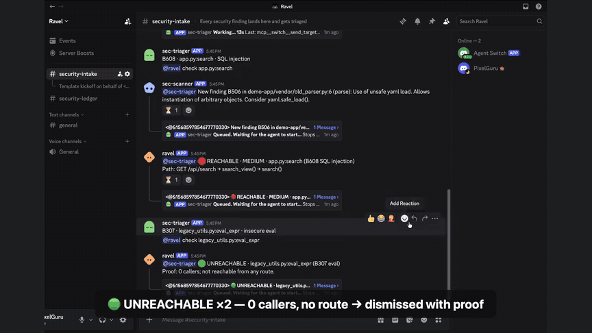

# Three findings, one real bug, one human "approved": building a security room on Switch

*Draft for the Flip the Switch hackathon (WeMakeDevs × DevTools Academy).*

[](https://www.youtube.com/watch?v=6GzCkDI_PWw)

## The problem we picked

AI now writes a lot of the code that gets merged. Review didn't get faster. Security
scanners make it worse in a strange way: they get louder. Run bandit on a normal Python
service and you get a list of "possible" problems, and most of them are dead code, vendored
files nobody imports, or `assert`s in tests. After a few weeks of that, people stop reading
the list, and the one finding that is real ships with everything else.

For each finding, a security engineer really wants to know one thing: **can outside input reach
this line?** If no web route, job or CLI ever calls the function, the finding can wait. If
`GET /api/search` reaches it in two hops, it can't.

We already had a tool that answers that question. **Ravel** is our codebase intelligence tool
for Python: it builds a call and import graph of a repo, finds the entry points (HTTP routes,
for example), and says for each scanner finding whether it is reachable and by which path.
What we didn't have was a place where that answer turns into a decision a team can see and
act on. That's what Switch gave us.

## What we built

**Ravel Security Room** is a Switch workflow that runs entirely in team chat:

```
3 scanner findings in
  → 2 dismissed with call-graph proof
  → 1 fixed on a branch by an agent
  → verified by Ravel
  → 1 human "approved" in chat → merged and logged
```

Four agents and three kinds of rooms:

| Agent | What it is | Job |
| --- | --- | --- |
| **sec-scanner** | Our script, registered as a Switch agent | Posts bandit's findings into `#security-intake` |
| **sec-triager** | Claude Code, run by Switch Console | Restates each finding, asks ravel, dismisses with proof or opens a fix room, writes the ledger |
| **ravel** | Our own program over the Switch Agent Protocol | `check`, `verify`, `who calls`, `wiki`, `attach wiki` |
| **sec-fixer** | Claude Code, run by Switch Console | Branches, patches, runs tests, asks ravel to verify, merges **only** after the security owner approves |

| Room | Purpose |
| --- | --- |
| `#security-intake` | Every finding lands here |
| `#fix-<kind>-<function>` | One room per real finding, created at run time by sec-triager |
| `#security-ledger` | One line per decision: an audit trail nobody has to write by hand |

The demo target is a tiny Flask shop with three planted findings:

- **B608, SQL injection** in `search()`, reachable from `GET /api/search`. Real.
- **B307, `eval()`** in `legacy_utils.eval_expr()`, which nothing calls. Noise.
- **B506, unsafe `yaml.load`** in `vendor/old_parser.py`, which nothing imports. Noise.

Here is what ravel says in chat, word for word:

```
@sec-triager 🔴 REACHABLE · MEDIUM · app.py:search (B608 SQL injection)
Path: GET /api/search → search_view() → search()

@sec-triager 🟢 UNREACHABLE · legacy_utils.py:eval_expr (B307 eval)
Proof: 0 callers; not reachable from any route.
```

None of this comes from an LLM. It's a graph lookup, it takes under a second, and it gives the
same answer every time. The LLM agents handle the routing and the patching, and the graph
handles the proof.

## Why Switch, specifically

We could have built a bot that posts a report. The interesting part was letting several
agents *work together* in the open, with a human holding the final say. Switch gave us these
pieces directly:

- **Rooms as the unit of work.** sec-triager creates `#fix-sqli-search` itself with its
  Switch tools (`create_room`, `invite_agent_to_room`, `add_users_to_room`), so each real
  finding gets its own room with only the people and agents that need to be there.
- **Addressing as the wake-up signal.** Agents only wake when someone `@mentions` them. We
  leaned into that: every ravel reply starts with `@<whoever asked>`, which is exactly what
  hands the turn back to sec-triager or sec-fixer.
- **Who may instruct whom.** sec-fixer is set to `owner-agents`. If someone other than the
  security owner types `@sec-fixer approved`, Switch refuses the message *before the agent
  sees it*. That refusal shows up in chat, which makes a nice moment in the demo.
- **Room knowledge.** ravel writes the affected module's wiki (its functions, routes, callers
  and open findings) into the fix room as a room document, so sec-fixer starts with context.
- **A custom agent over the Agent Protocol.** ravel isn't a prompt. It's a Python process that
  holds a WebSocket to the Switch server for events and posts replies over HTTP. It answers
  the server's pings, resumes from a saved cursor after a drop, and never answers a message twice.
- **One template for everything else.** `switch/security-room.template.yaml` creates both
  Claude Code agents, both rooms, their link and all of the agent instructions in one import.

The approval gate is the core claim of the project, so it has three layers: Switch addressing
(stops other people), sec-fixer's instructions (only the exact word `approved` from the
security owner's *human* account counts, so "looks good" doesn't merge and "approved" from
another agent doesn't either), and proof first (sec-fixer may only ask once `pytest` passes and
ravel says `FIX VERIFIED`).

## Set it up yourself

You need Python 3.11+, git, and [`uv`](https://docs.astral.sh/uv/) with Python 3.12+ for Ravel.
The first part needs no Switch at all:

```bash
git clone https://github.com/shreychechani/ravel-security-room.git
git clone https://github.com/shreychechani/Ravel.git
(cd Ravel && uv sync)

cd ravel-security-room
python3 -m venv .venv && source .venv/bin/activate
pip install -r requirements.txt
cp .env.example .env

./scripts/scan.sh                                      # 3 findings: B608, B307, B506
pytest demo-app/tests -q                               # 1 failed (on purpose), 1 passed
python ravel_adapter/adapter.py "@ravel check app.py:search"
python scripts/simulate_workflow.py                    # all 8 steps offline, mock agents
```

For the real thing, install Docker Desktop and Switch Console, then choose **Run a server on
this computer**. That gives you a local Switch server plus a bundled Mattermost. Then:

```bash
# Register our two custom agents (the template refers to them, so they come first)
python -m ravel_adapter.registration_key
python -m ravel_adapter.register ravel
python -m ravel_adapter.register sec-scanner

# Run ravel from its own worktree, so sec-fixer's branch switches can't move its code
git worktree add --detach ../ravel-run main
ln -s "$PWD/.env" ../ravel-run/.env
(cd ../ravel-run && ../ravel-security-room/.venv/bin/python ravel_adapter/adapter.py)
```

In Console, import `switch/security-room.template.yaml`. Give it your **chat** username and
the path of your clone, then select **Create all**. Then:

```bash
python scripts/post_findings.py     # the 3 findings land in #security-intake
```

Watch the chat, and type `@sec-fixer approved` when sec-fixer asks. `./scripts/reset_demo.sh`
puts everything back for the next run.

## The thing that broke: an approval gate that approved nobody

Our first full dry run *looked* perfect. Findings in, two dismissed, the fix room opened,
sec-fixer patched and tested, ravel verified. Then sec-fixer asked for approval from
`@{security_owner}`, curly braces and all.

The template had a `security_owner` field, and we used `{security_owner}` inside both agents'
instructions. In template **version 1**, placeholders in agent instructions are **not
filled in**. So the gate's one rule, "only this person may approve", named nobody. Nothing
crashed and nothing warned us. The gate was simply open in a way that was easy to miss.

Fixing it took three tries, and each one taught us something about Switch:

1. **Move to template version 2,** where placeholders are filled everywhere. We used the
   built-in `{$creator}` (the person running the template) as the security owner. The server's
   template check passed with 0 warnings.
2. **`{$creator}` gave the wrong name.** It resolves to the *Switch* account name (`Admin`),
   but approvals come from the *chat* account (the Mattermost username). sec-fixer would have
   waited for an approval from an account that never speaks in the channel. So
   `security_owner` became a plain text field again, labelled "Your chat username (no @)", and
   the kickoff message now makes sec-triager say the owner's name out loud. If it says
   `{security_owner}` or `Admin`, you know right away.
3. **Resource keys get replaced inside text.** When we renamed things, an agent came out as
   `sec-sec-triager`. Console resolves a resource key like `triager` by replacing that word
   *everywhere* in the template, including inside `sec-triager`. Our keys are now names that
   never appear in any text (`sec_triager`, `room_intake`), and `scripts/validate_template.py`
   checks for it.

The lesson: **a security gate has to show who it trusts.** "Ready, security owner is
@user" in the kickoff costs one line and catches the whole class of bug.

It carried over to Discord. There, Switch matches the approver by the account's **username**
(`sender_name`), while an @-mention of the same account is shown as its *display name*, so
sec-fixer's "please review" ping showed a different-looking name than the one the gate checks.
We confirmed it from ravel's first-message log before the run, and the merge commit names
the right account: "approved by @<username>". Linking your own Discord account in Console
("This is me") is the step that makes Switch treat you as sec-fixer's owner at all.

A second, smaller one from the same run: `@ravel verify fix/sqli-search search` came back
⚪ UNKNOWN. Ravel compared the fix branch against "the current checkout" as the before
state, but sec-fixer works in the same clone and had left the fix branch checked out, so
"before" already contained the fix. Now both sides are scanned in temporary git worktrees:
the commit the branch started from (`git merge-base main <branch>`) and the branch tip. We
also run ravel from its own worktree, so an agent changing branches can never change the
code that judges it.

## What's next

- Point it at any Python repo and trigger it on every pull request instead of a script.
- Several fix rooms in parallel, one per reachable finding, with severity-based routing.
- A security *team* instead of one owner, using Console's custom addressing rules.
- A weekly summary built from `#security-ledger`.

## Links

- Repo: https://github.com/shreychechani/ravel-security-room
- Ravel: https://github.com/shreychechani/Ravel
- Switch: https://github.com/sandbox-quantum/switch · docs: https://docs.switchagents.ai
- Demo video: https://www.youtube.com/watch?v=6GzCkDI_PWw
